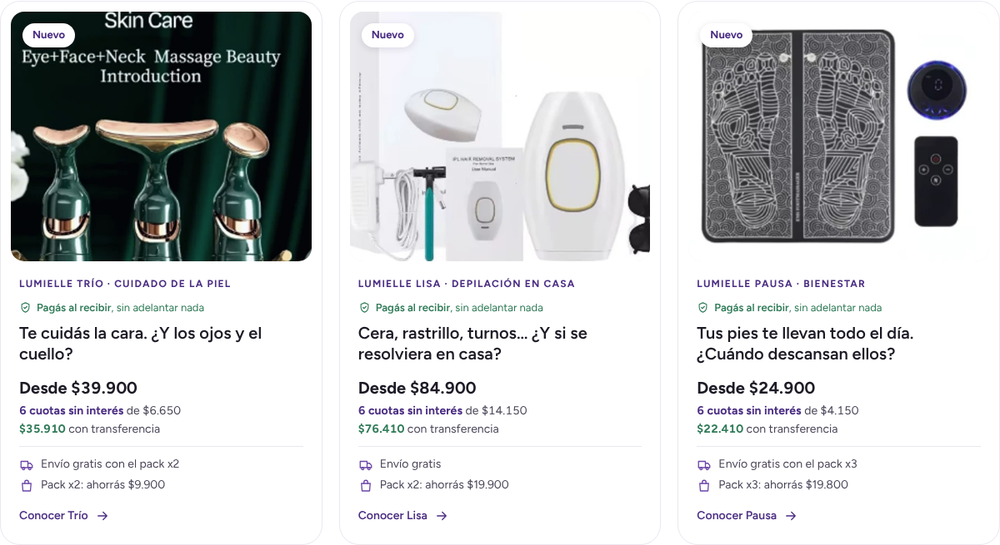

# Auditoría: cómo convierte Cleanfy y qué le sirve a Lumielle

6 de octubre de 2026.

## Alcance y límites

- El dominio que pasaste, **cleanfly.ar, no existe** (no resuelve). La tienda argentina es **[cleanfy.ar](https://cleanfy.ar/)**, de Cleanfy, el limpiador concentrado.
- La red de este entorno bloquea cleanfy.ar y lumielle.com.ar, así que no pude abrir la tienda ni sacar capturas. Lo de abajo sale de lo que los buscadores indexaron de su página. Si querés la auditoría completa (zona de compra, tarjetas, carrito y checkout medidos en 390 px), habilitá `cleanfy.ar` en la configuración de red del entorno o mandame capturas.
- Lo que no pude ver lo marco como "a verificar". No lo doy por hecho.

## Lo que hace Cleanfy (verificado en su página indexada)

| # | Elemento | Texto o dato | Qué palanca mueve |
|---|---|---|---|
| 1 | Prueba social con número exacto | "4,9/5 · 1.432 reseñas" | Un número no redondo y de más de mil se lee como real y como "mucha gente ya lo compró". Es la regla de la mayoría (Cialdini). |
| 2 | La tríada de confianza argentina | "Envío gratis a todo el país · Hasta 3 cuotas sin interés · Garantía de devolución" | Saca los tres miedos de comprar online en Argentina: costo sorpresa del envío, el golpe del precio (con inflación, las cuotas sin interés son un beneficio real) y "¿y si no me sirve?". |
| 3 | Valor por uso | "1 litro rinde hasta 100 litros" | Cambia la pregunta "¿es caro?" por "¿cuánto me cuesta cada uso?". Ancla de precio. |
| 4 | Simplificación | "Un solo envase reemplaza todo lo que tenés bajo la pileta" | Reduce decisiones: una compra resuelve muchas. |
| 5 | Kit con valor percibido | Concentrado + cepillo inalámbrico 7 en 1 (25 W, 350 RPM) + botella para dilución de 500 ml + 2 cepillos Premium | Muchas piezas visibles = "me llevo mucho". Sube el ticket sin bajar el precio. |
| 6 | Objeción respondida antes | "Poder abrasivo mínimo, no daña materiales, personas ni mascotas" | Responde el miedo ("¿es tóxico?") en la misma línea del beneficio. |
| 7 | Propósito | Concentrado, biodegradable, menos plástico y menos peso transportado | Le da a quien compra una razón "buena" además de la práctica. |
| 8 | Superlativo | "El limpiador más fuerte de Argentina" | Llama la atención, pero es un claim comparativo que hay que poder probar. **No copiar.** Además del riesgo legal (publicidad engañosa), Meta suele frenar superlativos sin respaldo. |

A verificar con la tienda abierta: cómo son sus tarjetas de producto (si muestran estrellas, cuotas, precio tachado o con transferencia), si tienen urgencia o contadores, pago al recibir, WhatsApp, pop-ups, sellos de pago y de correo, y cuántos pasos tiene el checkout.

## Lumielle frente a Cleanfy

| Palanca | Cleanfy | Lumielle hoy | Lectura |
|---|---|---|---|
| Reseñas | 4,9 · 1.432 | **0 pedidos reales y 0 reseñas** (los 3 pedidos de la tienda son pruebas anuladas de la crema) | Es la única brecha real. No se cierra con diseño: se cierra vendiendo y pidiendo la reseña. |
| Envío | Gratis a todo el país | Gratis desde $45.000; debajo, $5.000 | Lisa lo pasa sola; Trío lo pasa con el pack x2 y Pausa con el x3. Las tarjetas nuevas ya lo dicen así. |
| Cuotas | Hasta 3 sin interés | 3 y 6 sin interés | **Lumielle gana.** Ahora las tarjetas muestran el valor de la cuota: "6 cuotas sin interés de $6.650". |
| Transferencia | A verificar | 10 % con TRANSFER10 (código activo) | Las tarjetas lo muestran en escritorio. |
| Pago al recibir | A verificar | Activo | **Para quien no te conoce, es la palanca más fuerte.** Es lo que muestra la tarjeta mientras no haya reseñas. |
| Garantía | De devolución | 30 días + botón de arrepentimiento de 10 días (Ley 24.240) | Equivalente. |
| Kit o combo | Kit con 5 piezas | Packs x1/x2/x3 del mismo producto | Oportunidad: un combo real entre productos (por ejemplo, Trío + crema SADOER, "rutina de cuello completa"). |
| Valor por uso | "Rinde 100 L" | No se usa | Oportunidad con datos reales: Lisa trae 500.000 disparos y Pausa hace sesiones de 20 minutos sin turno. Evitá comparar contra precios de sesiones que no podés citar. |

## Qué apliqué a las tarjetas de la home

*Render local de la sección con los precios y la configuración reales de la tienda (la red del entorno no deja abrir la vista previa). En celular: `img/tarjetas-celular.png`.*

Tema **"Lumielle belleza en casa v2 (Claude)"**, sin publicar. Archivos: `sections/lm-home-hero.liquid` y `snippets/lm-card-proof.liquid`, que también están en `tema/` en este repo.

1. **Fila de prueba social con datos reales, en este orden:**
   - Estrellas y promedio, desde 10 reseñas de una app de reseñas (Judge.me, Shopify Product Reviews o Loox escriben los metacampos `reviews.rating` y `reviews.rating_count`). En celular sale como en Mercado Libre: "★ 4,8 (1.432)".
   - "+50 vendidos", desde el metacampo de producto `custom.vendidos`, redondeado como en Mercado Libre.
   - De 1 a 9 reseñas: "3 reseñas en Lumielle".
   - Sin datos (hoy): "Pagás al recibir, sin adelantar nada".
   - No hay campos para escribir puntajes a mano, como pide la guía de copy del sistema.
2. **Precio argentino:** "Desde $39.900", "6 cuotas sin interés de $6.650" y, en escritorio, "$35.910 con transferencia".
3. **Envío y ahorro del pack, calculados con los precios de Shopify:** Trío, "Envío gratis con el pack x2" y "Pack x2: ahorrás $9.900"; Lisa, "Envío gratis" y "Pack x2: ahorrás $19.900"; Pausa, "Envío gratis con el pack x3" y "Pack x3: ahorrás $19.800".
4. **Etiqueta "Nuevo"** los primeros 60 días desde la publicación (se configura en la sección). Explica por qué todavía no hay reseñas en lugar de dejar el hueco a la vista.

Todo sale de la configuración del tema: si apagás "Pagar al recibir", "Transferencia" o "Cuotas sin interés" en Medios de pago activos, la tarjeta deja de prometerlo.

## Cómo conseguir prueba social real (lo que Cleanfy ya tiene)

1. **Instalar una app de reseñas** que escriba los metacampos estándar (Judge.me tiene plan gratis). Las tarjetas toman las estrellas solas, sin tocar el tema.
2. **Pedir la reseña por WhatsApp** de 5 a 7 días después de la entrega, con link directo y la opción de mandar una foto. Las fichas ya invitan a hacerlo.
3. **Primeras unidades a clientas reales:** se puede regalar o descontar a cambio de una opinión honesta, aclarándolo en la reseña ("recibió el producto sin cargo"). Así lo exigen las reglas de Meta y la buena fe comercial.
4. **Contar ventas solas:** un flujo de Shopify Flow que, con cada pedido entregado, sume las unidades al metacampo `custom.vendidos`. Antes hay que crear la definición en Configuración → Datos personalizados → Productos (número entero, "Vendidos").
5. **UGC con permiso:** videos de clientas con usuario y red visibles. Las fichas ya tienen el carrusel de videos.

## Alertas que encontré de paso

- **La ficha de Trío dice "4,7 ★ · 71 reseñas" arriba del título.** Sale de `propias_cantidad: 71` y `propias_promedio: 4.7` en `templates/product.masajeador-facial.json` de este mismo tema, que se modificó hoy a las 12:46. Con 0 pedidos reales, son reseñas que no existen. Además, la propia ficha dice más abajo "Todavía no hay reseñas en la tienda". **Poné esos dos valores en 0 antes de publicar.** No lo cambié porque es un ajuste tuyo del editor.
- El interruptor global "Mostrar puntajes y cantidad de reseñas" (`reviews_real`) está encendido sin reseñas reales. Hoy no muestra nada inventado en las tarjetas (no hay datos), pero conviene apagarlo hasta tener reseñas.
- Las fotos de las tarjetas son del proveedor y la de Trío tiene texto en inglés. Los prompts para reemplazarlas están en `docs/prompts-fotos.md`.

## Fuentes

- [cleanfy.ar](https://cleanfy.ar/), contenido indexado por el buscador el 6/10/2026: puntaje, kit, envío, cuotas, garantía y claims.
- Baymard Institute, estadísticas de abandono de carrito (costos extra, desconfianza, devoluciones).
- Robert Cialdini, prueba social y autoridad.
- BJ Fogg, modelo B = MAP (facilidad antes que motivación).
